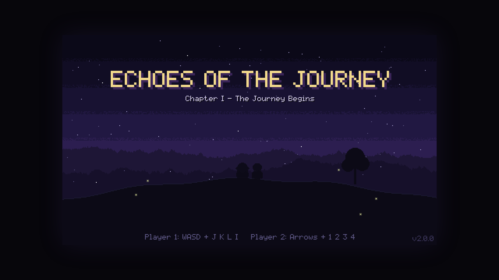
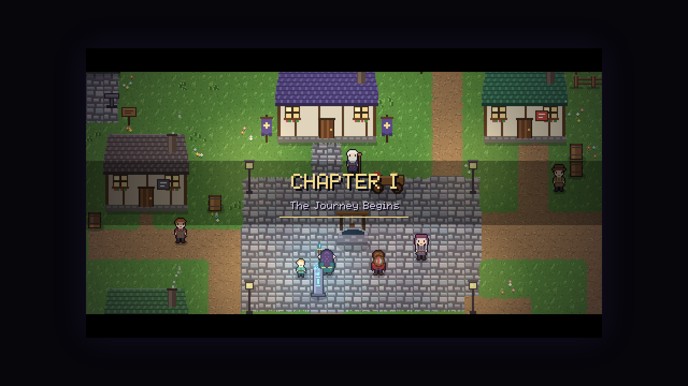

# Ecos da Jornada

Aventura cooperativa 2D em pixel art para dois jogadores no mesmo computador ou online por convite.

**Jogue no navegador:** https://ecos-alpha.vercel.app

## O jogo
Uma maga élfica que vive há séculos e um herói espadachim atravessam três capítulos sobre memória, passagem do tempo e cooperação. O jogo está completo, com final, créditos e pós-jogo para chegar aos 100%.

## Destaques
- **3 capítulos jogáveis** com regiões, mini-chefes e chefes.
- **Cooperativo**: dois jogadores no mesmo teclado, online por convite, ou modo solo com o parceiro controlado pelo computador.
- **Magias, técnicas e árvore de habilidades**, forja de equipamentos.
- **Missões secundárias, colecionáveis e áreas secretas**, viagem rápida, bestiário e diário com porcentagem de conclusão.
- **Arte, música e efeitos gerados por código**; roda no navegador, sem instalar nada.
- Em português e inglês.

## Telas

Desenvolvido por [@won3er](https://github.com/won3er).